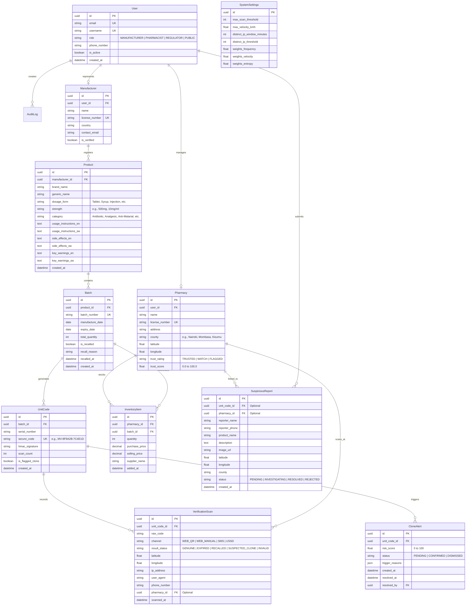

# Implementation Plan - MediVerify

**Project**: MediVerify - Counterfeit & Expired Medicine Verification System with Pharmacy Inventory & Cloned-Code Detection Engine  
**Context**: Kenyan Pharmaceutical Supply Chain & Public Verification  

---

## 1. System Architecture Overview

MediVerify is a full-stack, enterprise-grade anti-counterfeit system consisting of:
- **Backend Service**: Django 5.x + Django REST Framework (DRF) running on Python 3.12. Supports SQLite for zero-dependency local execution and PostgreSQL for production deployments.
- **Frontend SPA**: React 18 + Vite + Tailwind CSS + Lucide Icons + Leaflet/OpenStreetMap + PWA (Progressive Web App with offline fallback & camera QR scanner).
- **Authentication & RBAC**: Custom Django User model + SimpleJWT authentication supporting 4 distinct roles:
  1. `MANUFACTURER`: Register products, generate batches, export HMAC QR codes (PDF/CSV).
  2. `PHARMACIST`: Manage pharmacy inventory, receive expiry alerts, handle batch recalls.
  3. `REGULATOR` (Admin): Oversight dashboard, clone detection alerts, batch recall execution, report heat maps, system configuration.
  4. `PUBLIC` (Unauthenticated / Customer): QR/SMS/USSD verification, report suspicious medicines.
- **Security & Integrity Engine**: HMAC-SHA256 unit code generation (`token = hmac_sha256(secret_key, batch_id + unit_serial)`). Verification guarantees zero unguessable codes and server-side HMAC validation.
- **Cloned-Code Detection Engine**: Tri-factor rule engine + composite risk score (0-100):
  1. High frequency scan count threshold.
  2. Velocity / Impossible travel check using the **Haversine formula** (\( \Delta \text{distance} / \Delta \text{time} > 800\text{ km/h} \)).
  3. Device & IP entropy check (distinct IPs/User-Agents per code within rolling window).
- **Channels**: Web Browser (Camera/Manual), Interactive USSD Menu, and SMS gateway handler (integrated with Africa's Talking API & local interactive simulator).
- **Background Tasks**: Django-Q2 / Celery for automated daily expiry scans, alert notifications, and heavy evaluation benchmark simulations.

---

## 2. Database Schema (Mermaid ERD)



---

## 3. Core API Endpoint Architecture

| Method | Endpoint | Auth Level | Description |
| :--- | :--- | :--- | :--- |
| `POST` | `/api/v1/auth/register/` | Public | Register new user (Pharmacist/Manufacturer) |
| `POST` | `/api/v1/auth/login/` | Public | Obtains JWT pair (access/refresh) + user metadata |
| `GET` | `/api/v1/auth/me/` | Authenticated | Fetch authenticated user profile |
| `GET/POST` | `/api/v1/products/` | Manufacturer/Admin | List & create products |
| `GET/POST` | `/api/v1/batches/` | Manufacturer/Admin | List & create batches + generate HMAC unit codes |
| `GET` | `/api/v1/batches/{id}/export-qr/` | Manufacturer/Admin | Generate PDF QR sheet or CSV export |
| `POST` | `/api/v1/verify/` | Public | Main verification endpoint (Rate limited: 30/min per IP) |
| `GET` | `/api/v1/clones/alerts/` | Regulator/Admin | List clone detection alerts |
| `POST` | `/api/v1/clones/alerts/{id}/resolve/` | Regulator/Admin | Confirm or dismiss clone alert |
| `GET/POST` | `/api/v1/pharmacy/inventory/` | Pharmacist | Manage pharmacy inventory stock |
| `GET` | `/api/v1/pharmacy/alerts/` | Pharmacist | Fetch expiry & recall alerts for pharmacy stock |
| `GET` | `/api/v1/pharmacies/trust-ratings/` | Public | Public list of pharmacy trust ratings & badges |
| `POST` | `/api/v1/reports/suspicious/` | Public | Submit photo/description of suspicious medicine |
| `GET` | `/api/v1/reports/heatmap/` | Regulator/Admin | Map markers for fake reports & clone alerts |
| `POST` | `/api/v1/ussd/` | Public / Africa's Talking | USSD menu callback handler |
| `POST` | `/api/v1/sms/` | Public / Africa's Talking | SMS incoming text verification callback |
| `GET/POST` | `/api/v1/admin/settings/` | Regulator/Admin | Configure cloning thresholds & risk weights |

---

## 4. Cloned-Code Detection Engine Logic

The risk engine computes a weighted score between `0` and `100`:

$$ \text{Risk Score} = w_1 S_{\text{freq}} + w_2 S_{\text{vel}} + w_3 S_{\text{ent}} $$

Where:
1. **Frequency Score ($S_{\text{freq}}$)**:
   $$\min(100, \frac{\text{Scan Count}}{\text{Threshold}} \times 100)$$
2. **Velocity Score ($S_{\text{vel}}$)**:
   Calculated using Haversine distance between current scan $(lat_2, lon_2)$ and previous scan $(lat_1, lon_1)$ divided by time difference ($\Delta t$).
   $$\text{Velocity (km/h)} = \frac{\text{HaversineDistance}(p_1, p_2)}{\Delta t}$$
   If $\text{Velocity} > 800\text{ km/h}$, $S_{\text{vel}} = 100$, else $0$.
3. **Entropy / Distinct Device & IP Score ($S_{\text{ent}}$)**:
   Counts unique IP addresses / device fingerprints in the past $X$ minutes. If count > threshold, $S_{\text{ent}} = 100$.

If $\text{Risk Score} \ge 60$ or any critical rule triggers:
- Flag scan as `SUSPECTED_CLONE`.
- Create a `CloneAlert` record for regulator intervention.
- If admin confirms the alert, subsequent scans automatically return `SUSPECTED_CLONE`.

---

## 5. Technology Stack & Directory Layout

### Directory Structure
```
c:\PROJECTS\MEDIVERIFY\
├── backend/
│   ├── manage.py
│   ├── pytest.ini
│   ├── requirements.txt
│   ├── mediverify/
│   │   ├── __init__.py
│   │   ├── settings.py
│   │   ├── urls.py
│   │   ├── wsgi.py
│   │   └── asgi.py
│   ├── apps/
│   │   ├── authentication/
│   │   ├── verification/
│   │   ├── products/
│   │   ├── inventory/
│   │   ├── reports/
│   │   ├── gateway/         # SMS/USSD & AT Sandbox handlers
│   │   └── evaluation/      # Benchmark simulation engine
│   └── tests/
├── frontend/
│   ├── index.html
│   ├── package.json
│   ├── vite.config.js
│   ├── tailwind.config.js
│   ├── src/
│   │   ├── components/
│   │   ├── pages/
│   │   ├── services/
│   │   ├── context/
│   │   ├── utils/
│   │   └── App.jsx
└── docker-compose.yml
```

---

## 6. Development Phasing Plan

- **Phase 1**: Planning & Architecture Specifications (Done via this document, `TASKS.md`, `ASSUMPTIONS.md`).
- **Phase 2**: Django backend initialization, Custom User Auth, DRF JWT, database models, migrations, and seed data script (`python manage.py seed_data`).
- **Phase 3**: Products, Batches, HMAC unguessable unit code generation, PDF QR export sheet, CSV generator, and verification core endpoint.
- **Phase 4**: Cloned-code detection engine, Haversine velocity calculator, IP entropy checker, risk score calculator, CloneAlert model & Admin review API.
- **Phase 5**: Pharmacy inventory management, Expiry notification job (30/60/90 days), Batch recall notification pipeline, and Pharmacy Trust Rating calculation algorithm.
- **Phase 6**: Suspicious product reporting with image upload, Geolocation heat map API for Leaflet integration.
- **Phase 7**: Africa's Talking SMS & USSD webhooks, and an interactive in-app USSD/SMS Simulator frontend page.
- **Phase 8**: Vite + React + Tailwind frontend implementation (Public scan page with camera, Manufacturer portal, Pharmacist dashboard, Admin oversight dashboard with Leaflet map, Swahili/English toggle, PWA offline configuration).
- **Phase 9**: Full system testing, unit test suite (pytest), Vitest specs, security hardening (rate limiting, CSRF, XSS, upload validation), performance tuning.
- **Phase 10**: Evaluation toolkit: `evaluation_benchmark.py` script simulating 10,000 genuine scans, cloned attacks, spatial anomalies, producing markdown reports & accuracy matrices.
- **Phase 11**: OpenAPI/Swagger docs (`drf-spectacular`), deployment setup (Docker & docker-compose), VPS deployment guide, interactive demo script.
- **Phase 12**: Final IT Project Report support docs (`PROBLEM_STATEMENT.md`, `SYSTEM_DESIGN.md`, `TESTING_RESULTS.md`, `LIMITATIONS.md`).
